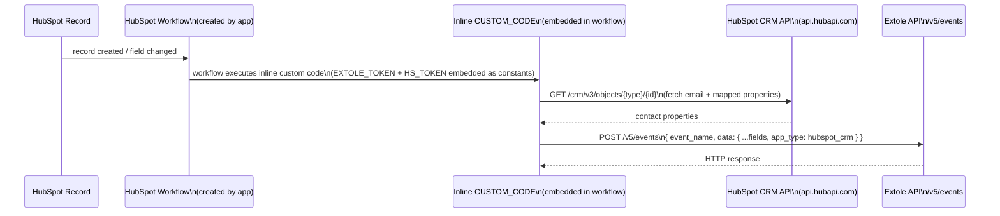
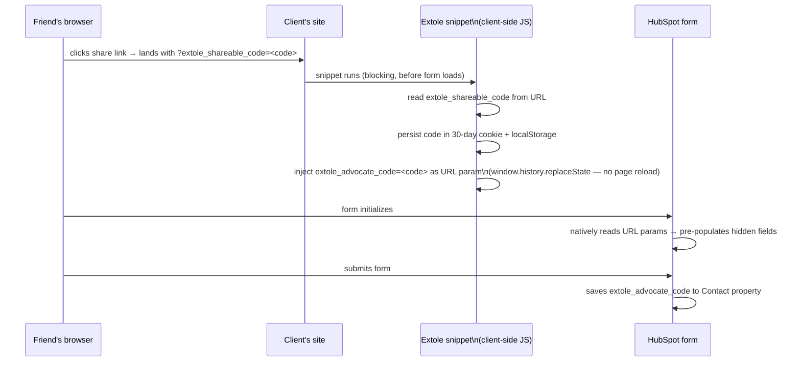
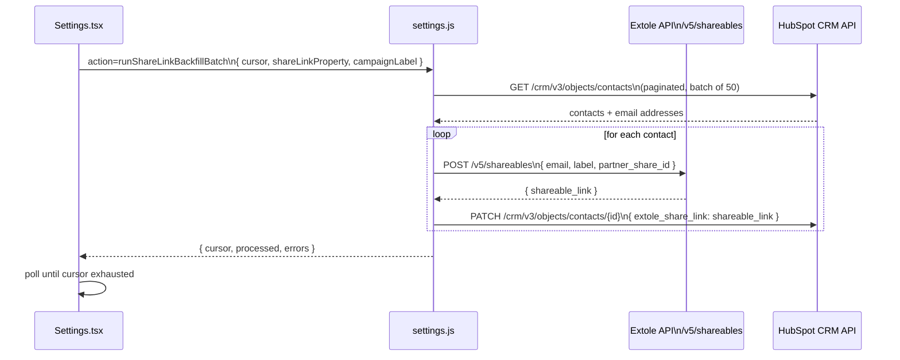
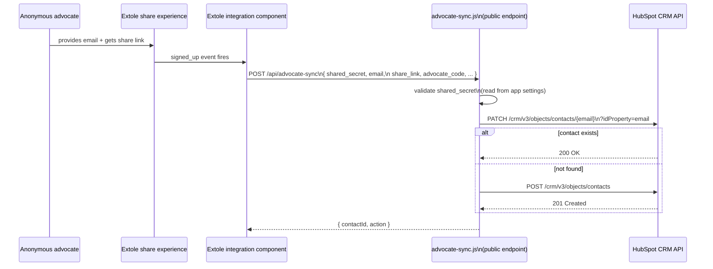

# Extole HubSpot App — Internal Architecture

## Overview

The app has four independent features that share a common auth and settings layer:

- **Configure Events** — Admin defines record-triggered events in the UI. The app creates a Custom Workflow Action; HubSpot invokes it when a matching record change occurs. The dispatch function fires the event to Extole in real time.
- **Manage Advocate Codes** — App generates a JavaScript snippet for the client's site. The snippet captures the advocate code from the share URL and persists it across page navigation so it can be injected into HubSpot forms, closing the friend attribution loop.
- **Manage Share Links** — App auto-generates Extole share links for Contacts and writes them back to a configurable Contact property. Supports auto-generate on create and bulk backfill for existing contacts.
- **Anonymous Advocate Sync** — Reverse-direction (Extole → HubSpot) public endpoint that receives webhook calls when an anonymous advocate provides their email in an Extole share experience. Upserts the matching HubSpot contact and writes the share link.

A CRM sidebar card on the Contact record surfaces the captured attribution data at a glance.

---

## Component Map

```
UI Extensions                     Serverless Functions              External
─────────────────────────────────  ────────────────────────────────  ────────────────────────
Settings.tsx (settings page)  →   settings.js (private)         →   Extole API (api.extole.io)
  Configure Events                   Settings CRUD                   HubSpot CRM API
  Manage Advocate Codes              Workflow CRUD                   (api.hubapi.com)
  Manage Share Links                 Share link generation
    Anonymous Advocate Sync          Advocate sync config
  Settings Log                       Log CRUD

NewCard.tsx (contact sidebar)       Workflow CUSTOM_CODE          →   Extole API
  Shows advocate code + utk         (inline JS embedded in each       /v5/events
  (reads Contact properties)         workflow at creation time)
                                     Calls HubSpot CRM API for
                                     properties, then fires event

(no UI — public webhook)            advocate-sync.js (endpoint)   ←   Extole webhook (POST)
                                       Validates shared_secret           https://<portalId>.hs-sites-
                                       Upserts contact (PATCH/POST       <region>.com/hs/serverless
                                         to api.hubapi.com)              /api/advocate-sync
```

---

## Auth Model

The app uses two tokens for all external calls. Neither appears in client-side code.

### Token 1 — HubSpot Private App Access Token

Used for: all HubSpot CRM API calls (Contact property CRUD, workflow CRUD, contact search, log object reads/writes).

```
HubSpot serverless runtime
  → auto-injects PRIVATE_APP_ACCESS_TOKEN into process.env
  → settings.js and dispatch.js read it as: process.env.PRIVATE_APP_ACCESS_TOKEN
  → appended as: Authorization: Bearer <token>
  → HubSpot CRM API (api.hubapi.com)
```

**Scopes required** (defined in `app-hsmeta.json`):

| Scope | Used for |
|---|---|
| `crm.objects.contacts.read/write` | Reading/writing Contact properties |
| `crm.schemas.contacts.read/write` | Creating custom Contact properties |
| `crm.objects.deals.read` | Deal event triggering |
| `crm.schemas.deals/companies.read` | Property lookup for field mapping |
| `tickets` | Ticket event triggering |
| `automation` | Workflow CRUD |
| `crm.schemas.custom.read/write` | Settings Log custom object |
| `crm.objects.custom.read/write` | Settings Log entries |
| `forms` | Form list for Form Configurator targeting |

This token is auto-injected by HubSpot in the deployed environment. It is **not available during local `hs project dev`** — auth errors from serverless calls are expected in local development mode.

---

### Token 2 — Extole API Token

Used for: connection test, event dispatch, share link generation, campaign list.

```
Admin pastes token in Settings → app stores it as HubSpot app secret: EXTOLE_API_TOKEN
  → settings.js reads it as: context.secrets.EXTOLE_API_TOKEN
    → used directly for: testConnection, share link generation, campaign list
    → at workflow creation time: embedded as a literal constant in generated workflow source code
        → generated workflow JS calls Extole directly (no runtime secret lookup)
  → appended as: Authorization: Bearer <token>
  → Extole API (api.extole.io)
```

**Setup:** Admin generates a long-lived token in the Extole Security Center, pastes it into the API Token field in the app's Settings tab, and clicks Test Connection.

**Token embedding:** HubSpot portal-level automation secrets (used by workflow custom code) are a separate store from project function secrets. Because `EXTOLE_API_TOKEN` is a project function secret (not an automation secret), it is not available at workflow custom code runtime via `process.env`. Instead, `settings.js` reads the token when creating or updating a workflow and writes it as a literal constant into the generated `CUSTOM_CODE` source. The same applies to `PRIVATE_APP_ACCESS_TOKEN` (Token 1) in the generated workflow code — it is also embedded at creation time rather than injected at runtime.

---

## Event Dispatch Flow



**Workflow structure:** Each event rule creates one HubSpot workflow with a `CUSTOM_CODE` action step. The generated JavaScript is self-contained — both the Extole token and the HubSpot token are embedded as literal constants at workflow creation time by `settings.js`. No callback to an app serverless function occurs at dispatch time.

**Identity payload:** The generated code always fetches and includes `email` plus any configured field mappings (e.g. `contact_id`, `first_name`, `last_name`). `app_type: hubspot_crm` is always appended.

**Token rotation:** Because tokens are embedded at creation time, updating the Extole API token in Settings does not automatically update existing workflow custom code. Use **Update Workflow** (or delete and recreate) to push a new token into existing workflows.

---

## Manage Advocate Codes Flow



**Cross-page persistence:** Cookie and localStorage survive navigation. On any subsequent page load (Scenario B), the snippet reads the code back from cookie/localStorage and injects it via `replaceState` before the form loads — no URL param required in the current URL.

**v2 vs v3 forms:** URL param pre-population works for both HubSpot form embeds:
- **v2** (`hbspt.forms.create`) — form script reads URL params at create time
- **v3** (`<div class="hs-form-frame">`) — deferred script reads URL params at load time

The snippet also wraps `hbspt.forms.create` as a secondary mechanism (hooks `onFormReady` and `onBeforeFormSubmit`) for environments where replaceState timing is unreliable.

**Required form setup:** HubSpot only saves fields explicitly defined on the form. `extole_advocate_code` must be added as a hidden field in the form builder for each form.

---

## Share Link Flow



**Auto-generate on create:** The `toggleAutoShareLink` action creates/removes a HubSpot workflow that fires the share link generation action on Contact create. New contacts get a share link automatically without manual backfill.

**Campaign targeting:** If a campaign label is configured, it is passed to the Extole shareables API to scope the share link to that program. Required while the default label workaround (`exhsappd`) is in place.

---

## Anonymous Advocate Sync Flow



**URL discovery:** The public URL is portal-specific and follows `https://<portalId>.hs-sites-<region>.com/hs/serverless/api/advocate-sync`. `settings.js#constructAdvocateSyncWebhookUrl` calls `/account-info/v3/details` (no extra scope needed) to read `portalId` + `dataHostingLocation` and constructs the URL for display in Settings. The admin copies it into the Extole integration component.

**Auth model:** Shared secret in the JSON body, not a header — HubSpot's serverless gateway strips all custom request headers before they reach the function (only Cloudflare-set headers like `cf-bot-score`, `true-client-ip`, etc. survive). The function reads the secret from app settings and rejects mismatches with 401.

**Body shape:**
```json
{
    "shared_secret": "<value>",
    "email": "advocate@example.com",
    "share_link": "https://...",
    "advocate_code": "abc123",
    "first_name": "Jane",
    "last_name": "Doe"
}
```

Only `shared_secret` and `email` are required. Empty fields are skipped during the upsert (advocate code stays untouched if not provided, etc.).

**Enabled toggle / regenerate:** The Settings UI exposes an enable/disable toggle plus a regenerate flow with inline confirmation. Regenerating writes a fresh 32-byte hex secret to app settings; old webhook calls fail until the Extole component is updated with the new value. Each event is recorded in the Settings Log (`advocate_sync_enabled`, `advocate_sync_disabled`, `advocate_sync_secret_rotated`, `advocate_sync` per inbound call).

---

## Data Model

### HubSpot Contact Properties (custom, created by the app)

| Property | Type | Purpose |
|---|---|---|
| `extole_advocate_code` | Single-line text | Advocate code captured at form submission; written by the Manage Advocate Codes snippet |
| `extole_share_link` | Single-line text | Extole share link URL; written back by Manage Share Links feature |

### HubSpot Custom Object — Settings Log

One entry per configuration action. Used by the Settings Log tab.

```
Extole_Settings_Log__c (custom object)
  ├── action        (property_created, workflow_created, workflow_deleted, ...)
  ├── actor         (email of the admin who performed the action)
  ├── timestamp     (ISO string)
  ├── details       (human-readable description)
  └── status        (success | error)
```

### HubSpot Workflows (managed by app)

One workflow per Configure Events rule, plus one workflow for Auto Share Link if enabled. Workflows are standard HubSpot workflows — visible and editable in the HubSpot Workflows UI.

---

## Function Inventory

### settings.js

| Action | Description |
|---|---|
| `testConnection` | Verify Extole API token is valid |
| `createProperties` | Ensure custom Contact properties exist (idempotent) |
| `validateProperty` | Check if a specific property exists |
| `checkProperties` | Bulk check property existence |
| `getObjectTypes` | List available HubSpot object types |
| `getObjectProperties` | List properties for a given object type |
| `getWorkflows` | List all Extole-created workflows |
| `getWorkflowConfig` | Get full config for a specific workflow |
| `createWorkflow` | Create workflow + action for an event rule |
| `updateWorkflow` | Update workflow event name or trigger config |
| `deleteWorkflow` | Delete a workflow |
| `toggleWorkflow` | Enable or disable a workflow |
| `probeEnrollment` | Test-fire a workflow against a sample contact |
| `getForms` | List HubSpot forms (for Form Configurator targeting) |
| `getCampaigns` | List Extole campaigns (for Share Link campaign targeting) |
| `createShareLinkProperty` | Ensure extole_share_link Contact property exists |
| `runShareLinkBackfillBatch` | Process one paginated batch of contacts for share link backfill |
| `getAutoShareLinkStatus` | Check whether auto-generate workflow is active |
| `toggleAutoShareLink` | Enable or disable the auto-generate share link workflow |
| `getAdvocateSyncConfig` | Read sync state + secret + auto-discovered webhook URL |
| `setAdvocateSyncEnabled` | Toggle the sync on/off; generates initial secret if enabling for the first time |
| `regenerateAdvocateSyncSecret` | Rotate the shared secret (returns the new value once) |
| `createLogSchema` | Ensure the Settings Log custom object exists |
| `getLogEntries` | Retrieve Settings Log entries |
| `clearLog` | Delete all Settings Log entries |

### advocate-sync.js

Public endpoint app function (`*-function-hsmeta.json` config: `endpoint.path: /api/advocate-sync`, `endpoint.methods: ["POST"]`). Receives webhook calls from the Extole HubSpot Advocate Sync integration component. Validates the shared secret against app settings, then upserts a HubSpot contact by email. See **Anonymous Advocate Sync Flow** above.

### dispatch.js

Legacy. Originally served as the HubSpot workflow action callback endpoint. Configure Events workflows now use inline `CUSTOM_CODE` with embedded tokens instead of a callback to this function. dispatch.js is still deployed but is not invoked by any current workflow.

---

## Key Behaviors for Maintainers

**PRIVATE_APP_ACCESS_TOKEN not available in local dev** — HubSpot only injects this token in the deployed runtime. Running `hs project dev` puts the portal in DEVELOPING LOCALLY mode, where calls from the local server cannot access `process.env.PRIVATE_APP_ACCESS_TOKEN`. All serverless calls that touch HubSpot APIs will fail with auth errors locally. Use `hs project upload` and test against the deployed build.

**Share link label workaround** — The Extole shareables API currently requires a `label` parameter even for clients without program segmentation. The constant `DEFAULT_SHARE_LABEL = 'exhsappd'` in settings.js provides a fallback. Remove it (set to `null`) once the Extole API fixes this requirement (ticket open).

**Workflow v3 vs v4 API** — Workflows are created via HubSpot's v4 automation API and listed/deleted via v4. The v3 API was initially used for listing but returned incomplete results and incompatible workflow IDs. All workflow operations should use v4 endpoints.

**HubSpot Tabs/Tab components** — The Settings UI uses a custom state-based navigation pattern instead of HubSpot's `Tabs`/`Tab` components. HubSpot's tab components freeze the subtree and block async state updates from adding DOM elements. Do not revert to HubSpot tabs.

**Log custom object schema** — The Settings Log custom object is created lazily on first log write. If the schema doesn't exist, `createLogSchema` is called automatically. The object type ID is stable per portal once created; do not delete the schema without clearing all log entries first.

**HubSpot's serverless gateway strips custom request headers** — public endpoint app functions (like `advocate-sync.js`) only receive a fixed set of Cloudflare-set headers: `cf-bot-score`, `true-client-ip`, `user-agent`, `host`, `content-type`, `content-length`, etc. Custom headers like `Authorization`, `x-extole-shared-secret`, etc. are dropped before reaching the function. Auth/identity must travel in the request body instead.

**Endpoint URL pattern for Projects-based public apps** — `https://<portalId>.hs-sites-<region>.com/hs/serverless<endpoint.path>`. The legacy CMS pattern (`<portal>.hs-sites.com/_hcms/api/...`) does NOT apply to Projects. The regional suffix (`-na2`, `-na1`, `-eu1`, etc.) is required and discoverable via `GET /account-info/v3/details` → `dataHostingLocation`. This URL pattern is undocumented in HubSpot's public docs as of 2026.05; the discovery is captured in `constructAdvocateSyncWebhookUrl` in settings.js.
